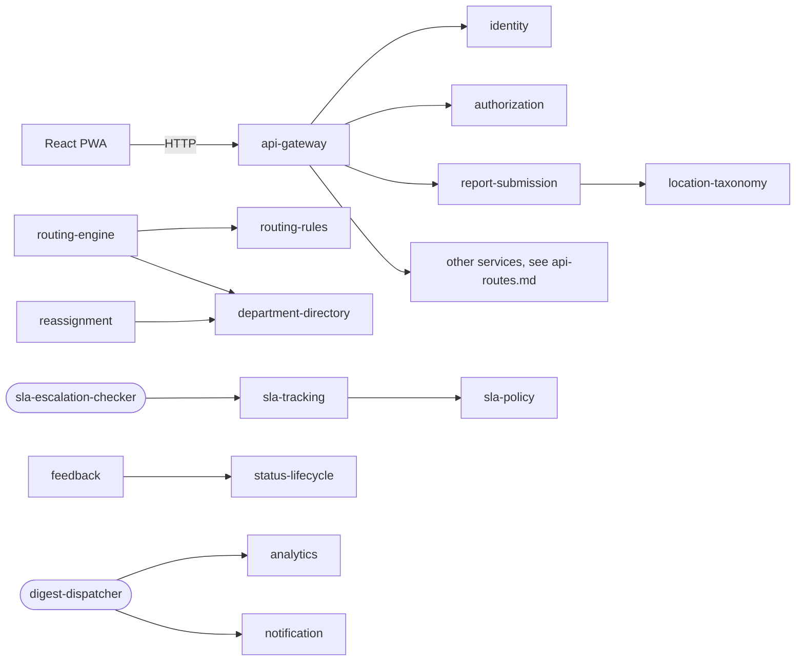

# Bounded contexts and service boundaries

Card: SCRUM-72. Owner: Sonam Zangmo. Sources: project proposal (section 4), `docs/pm/requirements.md`, `docs/design/database-schema.md`, the contracts in `proto/` (SCRUM-74).

## 1. Scope

Jurwa has **20 services and 2 serverless functions** in six domains. The proposal listed 25 services. Five were descoped in Sprint 1 and are not built: export, holiday-calendar, digest (replaced by the digest-dispatcher function), email-template and user-profile.

Every service is one bounded context: it owns its data and its rules, has its own database, and is reached only through its gRPC contract in `proto/<service>/v1/` or through events on Redis Streams. No service reads another service's database.

## 2. Domains

| Domain | Services | Functions | Owner |
|---|---|---|---|
| Identity and Access | identity, authorization | none | Gayley Choden |
| Reporting | report-submission, photo-media, report-history | none | Sonam Choki |
| Routing and Configuration | routing-rules, routing-engine, department-directory, category-taxonomy, location-taxonomy | none | Sonam Zangmo (location-taxonomy: Sonam Choki) |
| Lifecycle and SLA | status-lifecycle, sla-tracking, sla-policy, reassignment, audit-log | sla-escalation-checker | Nyendrak Yoezer Zangmo |
| Comms and Engagement | notification, feedback, analytics | digest-dispatcher | Gayley Choden |
| Platform | api-gateway, internal-notes | none | Sonam Zangmo (internal-notes: Sonam Choki) |
| **Total** | **20** | **2** | |

## 3. What each service owns

"Never" lists what the service must not do, even when it would be convenient. Requirement ids are from `docs/pm/requirements.md`.

### Identity and Access

| Service | Owns | Never | Store |
|---|---|---|---|
| identity (9016) | User accounts, password hashes, issuing and checking JWTs (FR-01, FR-24, FR-26) | Decide what a role may do; store or log plain passwords | PostgreSQL `identity` |
| authorization (9017) | The role, action, resource permission rules (FR-22, FR-26, FR-30); each user's roles are held by identity and travel in the token | Check passwords or issue tokens | PostgreSQL `authorization_db` |

### Reporting

| Service | Owns | Never | Store |
|---|---|---|---|
| report-submission (9001) | Validating and storing the report form; the report document (FR-02 to FR-05, FR-07) | Route a report or change its status after creation; status-lifecycle is the source of truth | MongoDB `report_submission` |
| photo-media (9002) | Photo bytes and their metadata, JPG or PNG up to 5 MB (FR-06) | Accept other file types; store report fields | MongoDB GridFS `photo_media` |
| report-history (9003) | Read model of report summaries, timelines and assignee queues, built from events (FR-08, FR-18, FR-22) | Accept writes from the PWA; it only listens to events | PostgreSQL `report_history` |

### Routing and Configuration

| Service | Owns | Never | Store |
|---|---|---|---|
| routing-rules (9006) | Which Category Head position receives each category (and optionally building) (FR-12, FR-25) | Read the description; know who holds a position | PostgreSQL `routing_rules` |
| routing-engine (9007) | The routing decision for a new report (FR-11, FR-12) | Read the description; store data; change status itself | None (stateless) |
| department-directory (9008) | Departments, positions (DSA, DAA, SSO, HoDs, councillors, staff) and their holders (FR-12, FR-19, FR-26) | Decide routing; manage logins | PostgreSQL `department_directory` |
| category-taxonomy (9009) | The category list, display names and order (FR-03, FR-27) | Decide who handles a category | PostgreSQL `category_taxonomy` |
| location-taxonomy (9004) | Valid buildings, wings and areas per category (FR-04, FR-27) | Decide routing | PostgreSQL `location_taxonomy` |

### Lifecycle and SLA

| Service | Owns | Never | Store |
|---|---|---|---|
| status-lifecycle (9011) | The current status of every report and the allowed transitions (FR-07, FR-12, FR-15, FR-16, FR-20, FR-23) | Let a user set ESCALATED; skip the version check | PostgreSQL `status_lifecycle` |
| sla-tracking (9012) | One SLA timer per report and its deadline (FR-14 to FR-16) | Decide the SLA window (sla-policy does); change status directly | Redis `sla:*` |
| sla-policy (9013) | The SLA window in hours per category (FR-13, FR-28) | Run timers | PostgreSQL `sla_policy` |
| reassignment (9014) | Who each report is assigned to, and the full assignment history (FR-16, FR-19) | Change status; decide the first routing | PostgreSQL `reassignment` |
| audit-log (9015) | Append-only record of every action (FR-17, FR-24) | Update or delete an entry | MongoDB `audit_log` |
| sla-escalation-checker (function) | Finding timers past their deadline on a schedule (FR-15) | Keep its own data; run between schedules (scales to zero) | None |

### Comms and Engagement

| Service | Owns | Never | Store |
|---|---|---|---|
| notification (9018) | Email and in-app messages and their delivery state (FR-09, FR-31) | Decide when something is worth notifying beyond its event rules; send SMS (out of scope) | PostgreSQL `notification` |
| feedback (9019) | One 1 to 5 rating per resolved report (FR-10) | Accept feedback before RESOLVED or from anyone but the reporter | PostgreSQL `feedback` |
| analytics (9020) | Dashboard counts built from events (FR-29) | Call other services' databases; accept writes from the PWA | PostgreSQL `analytics` |
| digest-dispatcher (function) | Building the periodic digest of open and escalated reports (FR-31) | Send email itself (notification does); keep its own data | None |

### Platform

| Service | Owns | Never | Store |
|---|---|---|---|
| api-gateway (8080 HTTP, 9010 gRPC) | The single HTTP entry point: JWT check, rate limit, HTTP to gRPC (FR-01, FR-02, FR-18, NFR-04). Routes in `docs/design/api-routes.md` | Hold business rules; take user ids from the request body | Redis `ratelimit:*` |
| internal-notes (9005) | Staff-only notes on a report (FR-21, FR-23) | Show notes to students | MongoDB `internal_notes` |

## 4. Who calls whom

### Synchronous gRPC calls

| Caller | Calls | RPC | Why |
|---|---|---|---|
| api-gateway | identity, authorization | ValidateToken, CheckPermission | Every protected request |
| api-gateway | the service behind each route | see `api-routes.md` | Forwards PWA requests |
| report-submission | location-taxonomy | ValidateLocation | Reject unknown locations |
| routing-engine | routing-rules | GetRule | Find the target position |
| routing-engine | department-directory | GetStaff | Find who holds the position |
| reassignment | department-directory | GetHoD, GetStaff | DAA reassigns to a HoD |
| sla-tracking | sla-policy | GetPolicy | Window for the deadline |
| feedback | status-lifecycle | GetStatus | Only after RESOLVED |
| sla-escalation-checker | sla-tracking | ListDueTimers | Find lapsed timers |
| digest-dispatcher | analytics, notification | GetSummary, SendNotification | Build and send the digest |

### Events on Redis Streams

Payloads are in `proto/events/v1/events.proto`.

| Stream | Published by | Read by |
|---|---|---|
| `events:report.submitted` | report-submission | routing-engine, status-lifecycle, report-history, analytics, audit-log |
| `events:report.routed` | routing-engine | reassignment, status-lifecycle, sla-tracking, audit-log |
| `events:status.changed` | status-lifecycle | report-submission, report-history, analytics, notification, sla-tracking, audit-log |
| `events:report.reassigned` | reassignment | report-history, notification, audit-log |
| `events:sla.lapsed` | sla-tracking | reassignment, status-lifecycle, notification, audit-log |
| `events:escalation.compensated` | status-lifecycle or reassignment | status-lifecycle, reassignment, report-history, analytics, audit-log |

Normal flow: submitted, then routing-engine routes it (report.routed), then reassignment records the first assignment, status-lifecycle sets ASSIGNED and sla-tracking starts the timer. When status-lifecycle publishes RESOLVED, sla-tracking stops the timer.

## 5. Escalation Saga

The escalation spans three services, so it is a choreographed Saga: each service reacts to an event, and a failed step is undone by a compensating action.

1. **sla-tracking publishes**: sla-escalation-checker finds a due timer, sla-tracking marks it LAPSED and publishes `sla.lapsed`.
2. **reassignment and status-lifecycle react**: reassignment records an ESCALATED assignment back to the Category Head, and status-lifecycle sets the status to ESCALATED, saving `previous_status`.
3. **Compensation**: if a step fails (for example the report was RESOLVED meanwhile, so the version check fails), that service publishes `escalation.compensated`. status-lifecycle restores `previous_status`, and reassignment restores the previous assignee with a COMPENSATED assignment. Every step is written to audit-log with the same `correlation_id`.

## 6. Open questions

| Question | Who decides |
|---|---|
| Who receives an escalation when the report is already with the Category Head (System Administrator, or only flagged on the President dashboard) | Team, with Nyendrak |
| Roles are owned by authorization, but identity puts them in the JWT at login. authorization needs an RPC such as `ListUserRoles` for this (contract change in Sprint 2) | Gayley |
| SLA window per category (from `database-schema.md`) | Team, then System Administrator |
