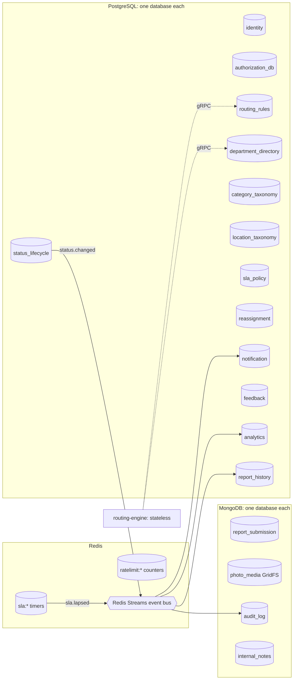

# Database schema design

Card: SCRUM-75. Author: Nyendrak Yoezer Zangmo. Sources: project proposal (section 4, "Data and security"), `docs/pm/requirements.md`, Sprint 1 decisions.

## 1. Rules

1. **One database per service.** No service reads or writes another service's database. Services get other data through gRPC calls or by listening to events on Redis Streams.
2. **No foreign keys across services.** A column such as `report_id` or `user_id` holds an id owned by another service. It is a plain UUID, checked through gRPC when needed.
3. **Ids are UUIDs** (strings in proto files). Times are `TIMESTAMPTZ` in PostgreSQL and `Date` in MongoDB, always UTC.
4. **Fixed values are upper-case codes**, matching the proto enums:
   - Status: `OPEN`, `ASSIGNED`, `IN_PROGRESS`, `RESOLVED`, `ESCALATED`
   - Category: `HOSTEL`, `ACADEMIC_BLOCK`, `OTHERS`
5. **Scripts are safe to re-run.** Every SQL file uses `CREATE ... IF NOT EXISTS` and `ON CONFLICT DO NOTHING`.
6. Connection details come from environment variables (`DATABASE_URL`, `MONGO_URL`, `REDIS_URL`), never from code.

## 2. Store per service (all 20)

| # | Service | Owner | Store | Database or keyspace | Why this store |
|---|---|---|---|---|---|
| 1 | report-submission | Sonam Choki | MongoDB | `report_submission` | A report is a document with a nested location |
| 2 | photo-media | Sonam Choki | MongoDB (GridFS) | `photo_media` | Binary files up to about 5 MB |
| 3 | report-history | Sonam Choki | PostgreSQL | `report_history` | Lists and queues filtered by user and status |
| 4 | location-taxonomy | Sonam Choki | PostgreSQL | `location_taxonomy` | Small reference list |
| 5 | internal-notes | Sonam Choki | MongoDB | `internal_notes` | Free-text notes per report |
| 6 | routing-rules | Sonam Zangmo | PostgreSQL | `routing_rules` | Structured rules with unique keys |
| 7 | routing-engine | Sonam Zangmo | None (stateless) | none | Reads rules through gRPC; decisions go to audit-log as events |
| 8 | department-directory | Sonam Zangmo | PostgreSQL | `department_directory` | Positions and holders |
| 9 | category-taxonomy | Sonam Zangmo | PostgreSQL | `category_taxonomy` | Small reference list |
| 10 | api-gateway | Sonam Zangmo | Redis | keys `ratelimit:*` | Rate-limit counters that expire |
| 11 | status-lifecycle | Nyendrak | PostgreSQL | `status_lifecycle` | Current status with strict checks |
| 12 | sla-tracking | Nyendrak | Redis | keys `sla:*` | Timers that must be found by deadline quickly |
| 13 | sla-policy | Nyendrak | PostgreSQL | `sla_policy` | One window per category |
| 14 | reassignment | Nyendrak | PostgreSQL | `reassignment` | Assignment history, one current row per report |
| 15 | audit-log | Nyendrak | MongoDB | `audit_log` | Append-only events with varied details |
| 16 | identity | Gayley Choden | PostgreSQL | `identity` | Accounts and password hashes |
| 17 | authorization | Gayley Choden | PostgreSQL | `authorization_db` | Roles per user |
| 18 | notification | Gayley Choden | PostgreSQL | `notification` | Outbox of messages and their delivery state |
| 19 | feedback | Gayley Choden | PostgreSQL | `feedback` | One rating per report |
| 20 | analytics | Gayley Choden | PostgreSQL | `analytics` | Read model for dashboard counts |

The event bus (Redis Streams) is shared infrastructure, not owned by one service. See section 6.

Totals: 13 PostgreSQL, 4 MongoDB, 2 Redis, 1 stateless.

## 3. Overview diagram



Each database box is used only by the service with the same name.

## 4. PostgreSQL services

The SQL in `docs/design/schema/<service>.sql` is the exact definition. Owners copy it into their service in Sprint 2. Required columns are `NOT NULL`. PK = primary key.

### identity (`identity.sql`)

| Table | Columns (type) | Required | PK | Indexes and checks |
|---|---|---|---|---|
| users | id UUID, email TEXT, full_name TEXT, password_hash TEXT, is_active BOOLEAN, created_at, updated_at TIMESTAMPTZ | all | id | unique on `lower(email)`; email contains `@` |

Passwords are stored only as a bcrypt hash (NFR-05).

### authorization (`authorization.sql`)

| Table | Columns (type) | Required | PK | Indexes and checks |
|---|---|---|---|---|
| roles | code TEXT, description TEXT | all | code | seeded: STUDENT, CATEGORY_HEAD, STAFF, SYSTEM_ADMIN, PRESIDENT |
| user_roles | user_id UUID, role_code TEXT, granted_by UUID, granted_at TIMESTAMPTZ | all except granted_by | (user_id, role_code) | index on role_code; role_code references roles |

### routing-rules (`routing-rules.sql`)

| Table | Columns (type) | Required | PK | Indexes and checks |
|---|---|---|---|---|
| routing_rules | id UUID, category_code TEXT, building TEXT ('' = any), target_position TEXT, priority INTEGER, is_active BOOLEAN, created_at, updated_at | all | id | unique (category_code, building); index on active category_code |

Seeded with the three agreed rules: HOSTEL to DSA, ACADEMIC_BLOCK to DAA, OTHERS to SSO.

### department-directory (`department-directory.sql`)

| Table | Columns (type) | Required | PK | Indexes and checks |
|---|---|---|---|---|
| departments | code TEXT, name TEXT, created_at | all | code | none |
| positions | code TEXT, title TEXT, kind TEXT, department_code TEXT, holder_user_id UUID, is_active BOOLEAN, updated_at | code, title, kind | code | kind in CATEGORY_HEAD, HOD, COUNCILLOR, STAFF; index on holder_user_id and active kind |

Seeded with the DSA, DAA and SSO positions. The 5 HoD departments are the engineering departments on https://cst.edu.bt/department/: Architecture (`ARCH`), Civil & Environmental Engineering (`CIVIL`), Computing Technologies (`CT`), Electrical & Electronics Engineering (`EEE`) and Mechanical Engineering (`MECH`). Position holders are entered by the System Administrator.

### category-taxonomy (`category-taxonomy.sql`)

| Table | Columns (type) | Required | PK | Indexes and checks |
|---|---|---|---|---|
| categories | code TEXT, name TEXT, description TEXT, sort_order INTEGER, is_active BOOLEAN, updated_at | all | code | seeded: HOSTEL, ACADEMIC_BLOCK, OTHERS |

### location-taxonomy (`location-taxonomy.sql`)

| Table | Columns (type) | Required | PK | Indexes and checks |
|---|---|---|---|---|
| locations | id UUID, category_code TEXT, building TEXT, wing TEXT, area TEXT, is_active BOOLEAN, created_at | all (wing and area default to '') | id | unique (category_code, building, wing, area); index on active category_code |

### sla-policy (`sla-policy.sql`)

| Table | Columns (type) | Required | PK | Indexes and checks |
|---|---|---|---|---|
| sla_policies | category_code TEXT, window_hours INTEGER, updated_by UUID, updated_at | all except updated_by | category_code | window_hours > 0 |

No rows are seeded because the SLA windows are not decided yet (see section 8).

### status-lifecycle (`status-lifecycle.sql`)

| Table | Columns (type) | Required | PK | Indexes and checks |
|---|---|---|---|---|
| report_status | report_id UUID, status TEXT, previous_status TEXT, version INTEGER, updated_by UUID, updated_at | report_id, status, version, updated_at | report_id | status and previous_status in the 5 codes; index on status |

`previous_status` lets the Saga undo an escalation. `version` goes up by one on every change, so two people changing the same report at the same time cannot overwrite each other (optimistic locking).

### reassignment (`reassignment.sql`)

| Table | Columns (type) | Required | PK | Indexes and checks |
|---|---|---|---|---|
| assignments | id UUID, report_id UUID, assignee_user_id UUID, assignee_position_code TEXT, kind TEXT, assigned_by UUID, reason TEXT, is_current BOOLEAN, assigned_at | all except assignee_position_code, assigned_by | id | kind in ROUTED, REASSIGNED, ESCALATED, COMPENSATED; unique report_id where is_current; index on current assignee_user_id; index (report_id, assigned_at) |

### notification (`notification.sql`)

| Table | Columns (type) | Required | PK | Indexes and checks |
|---|---|---|---|---|
| notifications | id UUID, recipient_user_id UUID, channel TEXT, event_type TEXT, report_id UUID, subject TEXT, body TEXT, delivery_status TEXT, created_at, sent_at, read_at | all except report_id, sent_at, read_at | id | channel in EMAIL, IN_APP; delivery_status in PENDING, SENT, FAILED; index (recipient_user_id, created_at); index on pending rows |

### feedback (`feedback.sql`)

| Table | Columns (type) | Required | PK | Indexes and checks |
|---|---|---|---|---|
| feedback | id UUID, report_id UUID, student_user_id UUID, rating SMALLINT, comment TEXT, created_at | all | id | unique report_id; rating 1 to 5; comment at most 500 characters |

### analytics (`analytics.sql`)

| Table | Columns (type) | Required | PK | Indexes and checks |
|---|---|---|---|---|
| report_facts | report_id UUID, category_code TEXT, building TEXT, status TEXT, was_escalated BOOLEAN, created_at, assigned_at, resolved_at, updated_at | all except assigned_at, resolved_at | report_id | index (category_code, status); index on created_at; index on escalated reports |

Built from events only. Analytics never calls other services' databases.

### report-history (`report-history.sql`)

| Table | Columns (type) | Required | PK | Indexes and checks |
|---|---|---|---|---|
| report_summaries | report_id UUID, reporter_id UUID, category_code, building, wing, area TEXT, status TEXT, current_assignee_id UUID, created_at, updated_at | all except current_assignee_id | report_id | index (reporter_id, created_at); index (current_assignee_id, status) |
| report_timeline | id UUID, report_id UUID, event_type TEXT, from_status, to_status TEXT, actor_id UUID, summary TEXT, occurred_at | id, report_id, event_type, summary, occurred_at | id | index (report_id, occurred_at); report_id references report_summaries (same database) |

## 5. MongoDB services

Collections are created on first insert. Indexes are created by the service at start-up (Sprint 2).

### report-submission: collection `reports`

```json
{
  "_id": "7d0c6c1e-...-uuid",
  "reporter_id": "uuid",
  "category": "HOSTEL",
  "location": { "building": "Hostel B", "wing": "East", "area": "Bathroom 2" },
  "description": "Tap is leaking since Monday",
  "photo_id": "uuid or absent",
  "status": "OPEN",
  "created_at": "2026-10-26T04:30:00Z"
}
```

| Field | Type | Required | Rule |
|---|---|---|---|
| _id | string (UUID) | yes | primary key |
| reporter_id | string (UUID) | yes | identity user id |
| category | string | yes | HOSTEL, ACADEMIC_BLOCK or OTHERS |
| location.building | string | yes | from location-taxonomy |
| location.wing, location.area | string | no | from location-taxonomy |
| description | string | yes | not blank, at most 500 characters |
| photo_id | string (UUID) | no | photo-media id |
| status | string | yes | `OPEN` on creation. status-lifecycle is the source of truth after that; this copy is updated from `status.changed` events |
| created_at | date | yes | set by the server |

Indexes: `{reporter_id: 1, created_at: -1}`, `{category: 1, status: 1}`.

### photo-media: GridFS bucket `photos`

The image bytes are stored in GridFS (`photos.files` and `photos.chunks`). Metadata on each file:

| Field | Type | Required | Rule |
|---|---|---|---|
| _id | string (UUID) | yes | photo id, referenced as `photo_id` |
| metadata.report_id | string (UUID) | no | set once the report is created |
| metadata.uploader_id | string (UUID) | yes | identity user id |
| contentType | string | yes | `image/jpeg` or `image/png` |
| length | number | yes | at most 5 242 880 bytes (5 MB) |
| uploadDate | date | yes | set by GridFS |

Index: `{"metadata.report_id": 1}`.

### audit-log: collection `audit_events` (append-only)

| Field | Type | Required | Rule |
|---|---|---|---|
| _id | string (UUID) | yes | primary key |
| occurred_at | date | yes | when the action happened |
| service | string | yes | service that published the event |
| action | string | yes | e.g. REPORT_SUBMITTED, ROUTED, STATUS_CHANGED, REASSIGNED, ESCALATED, COMPENSATED |
| report_id | string (UUID) | no | absent for actions not about a report |
| actor_id | string (UUID) | no | absent when the system acted |
| on_behalf_of | string | no | staff member without email that a supervisor acts for (FR-24) |
| details | object | no | action-specific fields, e.g. `{from: "OPEN", to: "ASSIGNED"}` |

Indexes: `{report_id: 1, occurred_at: 1}`, `{actor_id: 1, occurred_at: -1}`, `{action: 1, occurred_at: -1}`. Documents are never updated or deleted.

### internal-notes: collection `notes`

| Field | Type | Required | Rule |
|---|---|---|---|
| _id | string (UUID) | yes | primary key |
| report_id | string (UUID) | yes | report the note belongs to |
| author_id | string (UUID) | yes | Category Head or staff user |
| body | string | yes | not blank |
| created_at | date | yes | set by the server |

Index: `{report_id: 1, created_at: 1}`. Notes are never shown to students (FR-21).

## 6. Redis

### sla-tracking timers (prefix `sla:`)

| Key | Type | Content |
|---|---|---|
| `sla:deadlines` | sorted set | member = report_id, score = deadline as Unix seconds |
| `sla:timer:<report_id>` | hash | category, started_at, deadline, state (RUNNING, STOPPED, LAPSED) |

A timer starts when a report is routed and stops when it is Resolved (FR-14). The `sla-escalation-checker` function asks sla-tracking for timers due, which runs `ZRANGEBYSCORE sla:deadlines 0 <now>`.

### api-gateway rate limits (prefix `ratelimit:`)

| Key | Type | Content |
|---|---|---|
| `ratelimit:<user_id or ip>:<minute>` | string counter | `INCR` on each request, `EXPIRE` 60 seconds |

### Event bus (Redis Streams)

| Stream | Published by | Read by (consumer groups) |
|---|---|---|
| `events:report.submitted` | report-submission | routing-engine, status-lifecycle, report-history, analytics, audit-log |
| `events:report.routed` | routing-engine | reassignment, status-lifecycle, sla-tracking, audit-log |
| `events:status.changed` | status-lifecycle | report-submission, report-history, analytics, notification, sla-tracking, audit-log |
| `events:report.reassigned` | reassignment | report-history, notification, audit-log |
| `events:sla.lapsed` | sla-tracking | reassignment, status-lifecycle, notification, audit-log |
| `events:escalation.compensated` | status-lifecycle or reassignment | report-history, analytics, audit-log |

Each reading service uses its own consumer group named after the service. The final stream names and payloads are fixed with the proto contracts (SCRUM-74).

## 7. How to test the SQL

From the repo root, in PowerShell:

```powershell
docker run --name pgtest -e POSTGRES_PASSWORD=test -p 5433:5432 -d postgres:16
docker cp docs/design/schema pgtest:/schema
docker exec -i pgtest bash /schema/test-schema.sh
docker rm -f pgtest
```

`test-schema.sh` creates one database per file, runs each file twice (to prove it is safe to re-run) and prints `OK` with the tables created.

## 8. Open questions

| Question | Who decides |
|---|---|
| SLA window in hours for each category (no rows seeded in `sla_policies`) | Team, then System Administrator |
| routing-engine is stateless (no database). Confirm | Sonam Zangmo |
| Feedback rating scale 1 to 5. Confirm | Gayley Choden |
| Final event stream names and payloads | Fixed in SCRUM-74 contracts |
