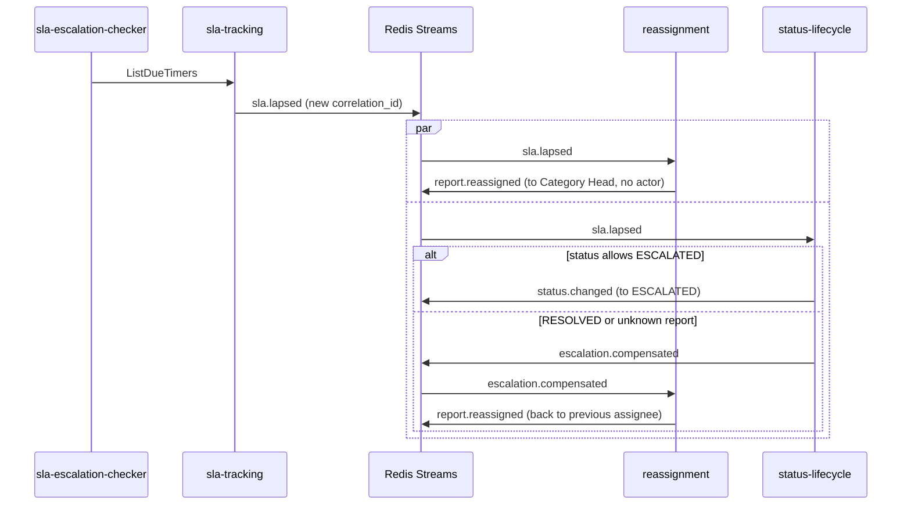

# Escalation Saga

Card: SCRUM-89. Owner: Nyendrak Yoezer Zangmo. Services: sla-tracking, reassignment, status-lifecycle. Event bus: `pkg/eventbus` (Redis Streams), payloads in `proto/events/v1/events.proto`.

When a report's SLA lapses, it is handed back up to its Category Head and set to ESCALATED. The two changes are made by two services, so this is a **choreographed Saga**: each service reacts to an event, and when a step fails an earlier step is undone by a compensating action. No service calls another for this.

## Before the Saga: how a report gets a status, an assignee and a timer

All from events, with no seed setting (each service reads in its own consumer group):

| Event | Published by | Read by | What happens |
|---|---|---|---|
| `report.submitted` | report-submission | status-lifecycle | The report gets OPEN |
| `report.routed` | routing-engine | status-lifecycle | ASSIGNED, set by the system ("routed to DSA") |
| `report.routed` | routing-engine | reassignment | The Category Head (`category_head_id`, `target_position`) is recorded as the first ROUTED assignee |
| `report.routed` | routing-engine | sla-tracking | The SLA timer starts, with the deadline from sla-policy |
| `status.changed` to RESOLVED | status-lifecycle | sla-tracking | The timer stops, so a resolved report is never escalated |

`report.routed` can be read before `report.submitted`, because the two streams are read in parallel. status-lifecycle then registers the report itself, and the late `report.submitted` counts as done. A repeated event changes nothing: an existing status, assignment or timer counts as done. If sla-tracking cannot start a timer (for example no SLA window is set for the category), the event is tried 3 times and then kept in `events:report.routed.dead`, where it can be seen.

Tests: `tests/saga/flow_test.go` (submitted and routed, then escalated after the SLA; resolved stops the timer; routed before submitted; repeated routed event).

## Happy path

1. The `sla-escalation-checker` function calls sla-tracking `ListDueTimers`. sla-tracking marks the timer LAPSED and publishes `events:sla.lapsed`. That event starts one Saga run: it gets a new `correlation_id`, and every later event of the run repeats it.
2. **reassignment** (group `reassignment`) hands the report back to the Category Head: the first ROUTED assignee, with its position code. It saves an ESCALATED assignment and publishes `events:report.reassigned` with no `actor_id`, because the system acted.
3. **status-lifecycle** (group `status-lifecycle`) sets the status to ESCALATED as the system, saves `previous_status`, and publishes `events:status.changed`.

Steps 2 and 3 run in parallel. Neither waits for the other.

## Failure path and compensation

status-lifecycle cannot set ESCALATED when the flow does not allow it (the report is already RESOLVED, for example because the event that stops the timer was lost) or when it does not know the report. It then publishes `events:escalation.compensated`:

| Field | Value |
|---|---|
| `failed_step` | `status-lifecycle.set-escalated` |
| `undone_step` | `reassignment.escalate` |
| `reason` | the error, for example `invalid status transition: RESOLVED to ESCALATED` |

reassignment reads it and gives the report back to the person who held it before the escalation (a COMPENSATED assignment), then publishes `events:report.reassigned` again.

**Choice for a lapse on a RESOLVED report (guide scenario b):** reassignment does not check the status first. It cannot, because the status belongs to status-lifecycle. It escalates, and the compensation undoes it. Both failure cases (RESOLVED, unknown report) therefore use the same mechanism.

## Rules every handler follows

| Rule | How |
|---|---|
| A repeated event changes nothing | Each service remembers the `event_id`s it handled and ignores a repeat |
| The undo can arrive before the escalation | reassignment remembers undone runs by `correlation_id`. A lapse of an undone run arriving later is skipped. Its two Saga handlers run one at a time, so the undo cannot slip in between the check and the escalation |
| A report already ESCALATED counts as done | The `sla-escalation-checker` function also sets ESCALATED directly (SCRUM-27), so status-lifecycle may find it done. That is not a failure and no compensation is sent |
| A version conflict is retried | status-lifecycle returns the error. The bus tries the event 3 times, then moves it to `<stream>.dead` |
| One correlation id per run | Set by sla-tracking on `sla.lapsed`, copied into every event of the run |

## Limits (known)

- The handled `event_id`s and undone runs are kept in memory. After a restart a repeated event is still caught (status-lifecycle: ESCALATED counts as done; reassignment: nothing to undo when the current assignment is not ESCALATED), but a lapse of a run undone before the restart could escalate again. The PostgreSQL adapters can store them.
- The "one at a time" lock is per process. With several reassignment pods, a lapse and its undo could run on two pods at once. Run one replica until the lock is in the database.
- When reassignment cannot escalate (routing never assigned the report), the status still becomes ESCALATED: the SLA did lapse, and the Category Head sees it on the dashboard.
- If the report is already with the Category Head, the escalation is still recorded (an ESCALATED assignment to the same person) so the history and `report.reassigned` show it. Who receives it instead is an open question in `bounded-contexts.md`.

## Tests

`tests/saga/saga_test.go` wires the application layers of the three services to one `eventbus.NewMemory()` (no gRPC, no Redis):

| Test | Scenario |
|---|---|
| `TestSaga_LapseEscalatesReportAndHandsItUp` | (a) happy path: ESCALATED, back with the Category Head, events after the lapse |
| `TestSaga_ResolvedReport_EscalationIsUndone` | (b) RESOLVED report: compensation published, previous assignee back, still RESOLVED |
| `TestSaga_StatusStepFails_PreviousAssigneeIsBack` | (c) status step fails (unknown report): same compensation |
| `TestSaga_RepeatedEvent_EscalatesOnce` | (d) the same `sla.lapsed` twice escalates once |
| `TestSaga_OneCorrelationIDThroughTheRun` | (e) every event of a run carries its lapse's `correlation_id`, every event has its own `event_id` |

Run: `go test ./tests/saga/... -v`. The tests passed 200 runs in a row (`-count=100`, twice) after the fix for the undo-before-escalation race, which an earlier 30-run check had found.
