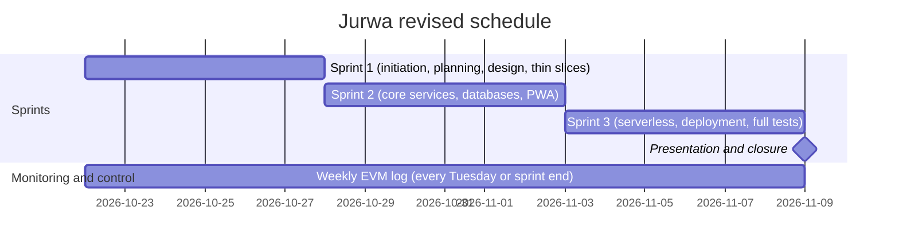

# Schedule and EVM baseline

Card: SCRUM-79. Author: Nyendrak Yoezer Zangmo. Sources: project proposal (sections 4D and 5D, 7 October 2026), project charter (`docs/pm/charter.md`), Jira project SCRUM.

All effort is in **person-hours**. The budget in money is zero, so hours are the "cost" that EVM tracks.

## 1. Work breakdown structure (baseline)

The eight work packages and their planned effort come from the proposal (section 4D) and are unchanged.

| WP | Work package | Main activities | Planned hours |
|---|---|---|---|
| 1.1 | Initiation | Project charter; stakeholder register; requirements gathering | 20 |
| 1.2 | Planning | WBS and schedule; risk register; quality management plan; communications plan | 25 |
| 1.3 | System design | Learning spike (Kubernetes, gRPC, Knative); bounded contexts; gRPC contracts; database schema; UI/UX wireframes | 35 |
| 1.4 | Implementation | Service domains; 2 serverless functions; PWA front end | 160 |
| 1.5 | Testing | Unit, integration, end-to-end, performance and accessibility tests | 70 |
| 1.6 | Deployment | Dockerfiles and images; Kubernetes manifests (k3d); CI (GitHub Actions); CD (Argo CD); observability | 30 |
| 1.7 | Monitoring and control | Status reports and EVM; issue log and risk review | 10 |
| 1.8 | Closure | Final presentation; lessons learned; archive handover | 10 |
| | **Total (Budget at Completion, BAC)** | | **360** |

Check: 20 + 25 + 35 + 160 + 70 + 30 + 10 + 10 = 360.

## 2. Revised schedule

The proposal planned 8 weeks (8 October to 30 November 2026). The charter replaces this with three five-day sprints.

| Sprint | Dates (2026) | Work packages | Goal (from the charter) |
|---|---|---|---|
| Sprint 1 | 22 to 27 Oct | 1.1, 1.2, 1.3, start of 1.4 and 1.6, 1.7 | Charter, requirements, plans, wireframes, service template, gRPC contracts, k3d cluster, CI, one thin-slice service per owner |
| Sprint 2 | 28 Oct to 3 Nov | 1.4, 1.5, 1.7 | Core services implemented with unit tests, databases, PWA front end |
| Sprint 3 | 4 to 10 Nov | 1.4 (serverless), 1.5, 1.6, 1.7 | Serverless functions, full deployment through Argo CD, full test suite, observability |
| Presentation | about 9 Nov | 1.8 | Final presentation, live demo and closure report |

## 3. Remaining effort and Planned Value per sprint

The team's Sprint 1 plan uses **280 hours remaining** across the three sprints.

| Measure | Value | How it is calculated |
|---|---|---|
| Remaining effort | 280 h | Team's Sprint 1 plan |
| Per sprint | about 93.3 h | 280 / 3 |
| Per person per sprint | about 23.3 h | 93.3 / 4 members |

280 is 360 minus 80. WP 1.1 to 1.3 add up to exactly 80 hours (20 + 25 + 35). The proposal scheduled them for weeks 1 and 2 (8 to 21 October). See open question 1.

**Planned Value (PV)** is the budgeted hours of work that should be finished by a given date.

| Checkpoint | PV this sprint | Cumulative PV |
|---|---|---|
| End of Sprint 1 (27 Oct) | 93.3 h | 93.3 h |
| End of Sprint 2 (3 Nov) | 93.3 h | 186.7 h |
| End of Sprint 3 (10 Nov) | 93.3 h | 280.0 h |

## 4. EVM formulas

| Term | Meaning | Where the number comes from |
|---|---|---|
| PV (Planned Value) | Hours of work planned to be done by now | Section 3 of this document |
| EV (Earned Value) | Planned hours of the work actually finished | Sum of the estimates of Jira cards in Done |
| AC (Actual Cost) | Hours actually spent | Sum of hours logged in Jira |
| CV (Cost Variance) | EV - AC | Negative means more hours spent than the finished work was worth |
| SV (Schedule Variance) | EV - PV | Negative means behind schedule |
| CPI (Cost Performance Index) | EV / AC | Below 1 means over budget: the work cost more hours than planned |
| SPI (Schedule Performance Index) | EV / PV | Below 1 means behind schedule: less work is finished than planned |

A value of exactly 1 means on plan. Above 1 means better than plan.

### Worked example (hypothetical numbers, end of Sprint 1)

Suppose cards with estimates adding up to 70 h are Done, and the team logged 80 h.

| Metric | Calculation | Result | Reading |
|---|---|---|---|
| PV | from section 3 | 93.3 h | |
| EV | sum of Done card estimates | 70 h | |
| AC | hours logged | 80 h | |
| CV | 70 - 80 | -10 h | 10 hours more spent than earned |
| SV | 70 - 93.3 | -23.3 h | 23.3 hours of planned work not finished |
| CPI | 70 / 80 | 0.875 | Over budget: each hour spent earned 0.875 h of planned work |
| SPI | 70 / 93.3 | 0.750 | Behind schedule: 75% of the planned work is done |

Check of the proposal's own Week 4 example: CPI = 160 / 188 = 0.851 (0.85), SPI = 160 / 187 = 0.856 (0.86). Both match the proposal.

### Rules for the weekly log

1. Every card in a sprint needs an **original estimate** in Jira before the sprint starts. Without it, EV cannot be calculated.
2. Everyone logs their hours on their cards by Tuesday (sprint end).
3. A card counts towards EV only when it is Done (merged and moved to Done). No partial credit.
4. If CPI or SPI is below 0.9, the log lists actions for the next sprint (risk R4).
5. Unknown numbers are left blank and marked as unknown. Hours are never invented.

## 5. Change log (proposal to current plan)

| # | Change | From | To | Reason | Approved |
|---|---|---|---|---|---|
| C1 | Services cut | 25 services | 20 services (export, holiday-calendar, digest, email-template and user-profile removed; digest emails handled by the `digest-dispatcher` function) | Less time is available (C2). Risk R4 says the lowest-priority services are cut first; testing and documentation are never cut | Charter, full team |
| C2 | Schedule compressed | 8 weeks (8 Oct to 30 Nov), presentation 26 to 30 Nov | 3 five-day sprints (22 Oct to 10 Nov), presentation about 9 Nov | Presentation date moved to about 9 Nov. **Team to confirm the exact reason before merge** | Charter, full team |
| C3 | Work split | 6 or 7 services per member (25 total) | 5 services per member, plus one serverless function for two members | 20 services split evenly, so each member has the same load (about 23 h per sprint) and every member owns part of the critical path | Charter, full team |

## 6. Current state of Jira (checked 26 Oct 2026)

- Cards exist for all members, but **no card has an original estimate and no hours are logged yet**.
- Some older cards still describe the 25-service plan (for example holiday-calendar SCRUM-87, email-template SCRUM-95, digest SCRUM-96). They should be closed as "Won't do" to match change C1.

Actions before the first EVM log (SCRUM-82, Tuesday 27 Oct):

1. Each owner adds an original estimate to their Sprint 1 cards, so the estimates add up to the Sprint 1 PV (93.3 h).
2. Each owner logs the hours already spent.
3. The Scrum Master closes the descoped cards.

## 7. Open questions

| # | Question | Who decides |
|---|---|---|
| 1 | Are the 80 h for WP 1.1 to 1.3 counted as spent before Sprint 1 (BAC for tracking = 280 h), or are they still planned inside Sprint 1 (BAC = 360 h)? This changes PV for Sprint 1. | Scrum Master and Team Lead |
| 2 | Exact reason for compressing the schedule (C2) | Team Lead |
